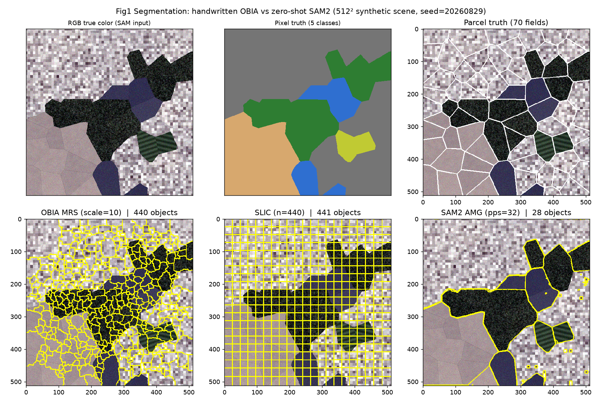
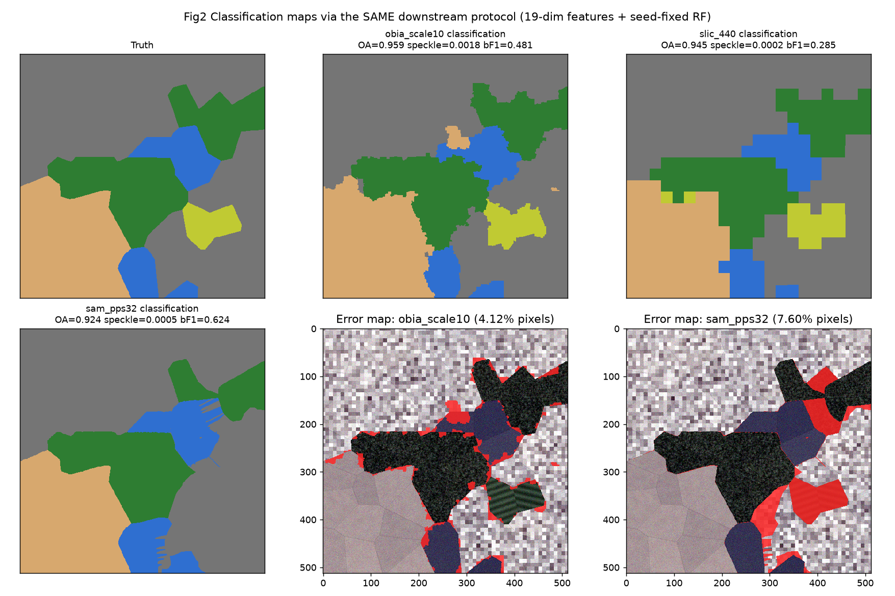
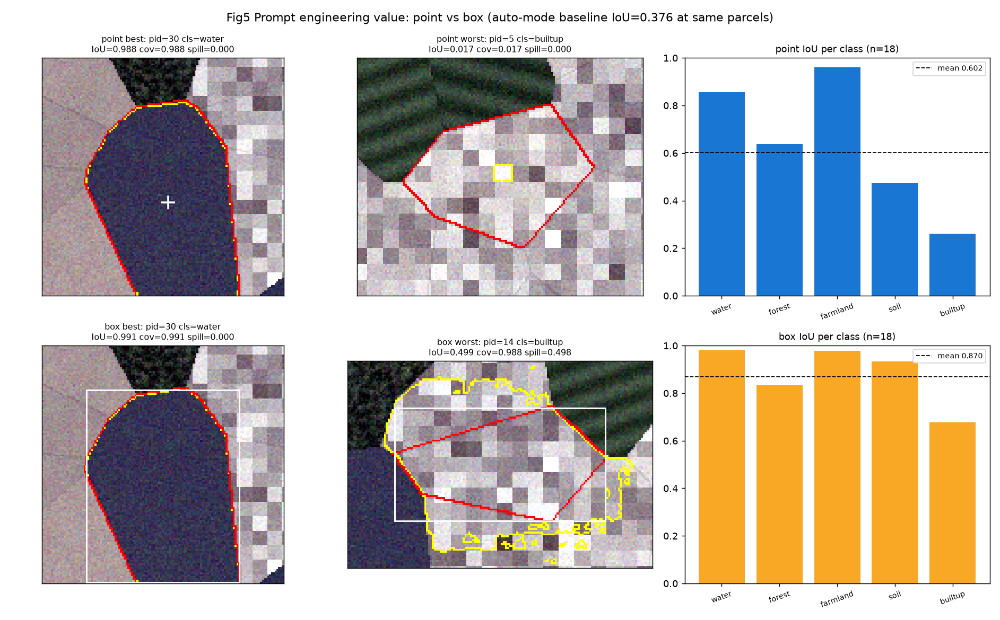
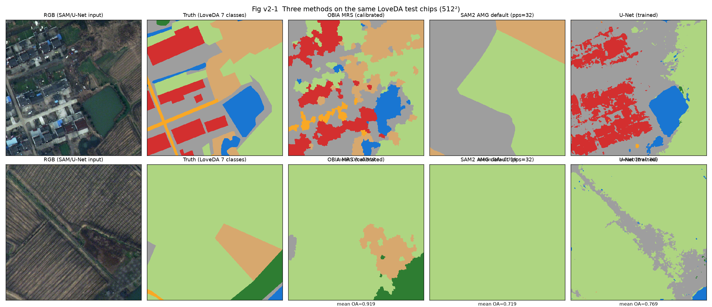
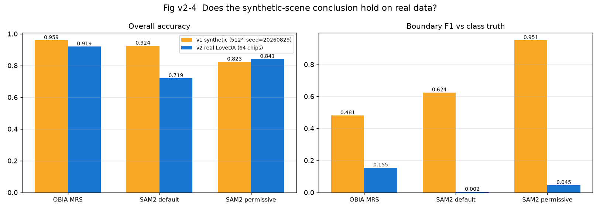

# 当 Meta 的 SAM 遇上手写 OBIA：遥感分割的零样本正面对比

> **v2（2026-11-22）：真实数据集验证已完成**，见下方 [§9 v2 章节](#9-v2真实数据验证--loveda-三方案对比)。合成场景的结论哪些成立、哪些翻转，都有了答案。

> **同一幅 512²×4 波段合成场景（seed=20260829）、同一套下游分类协议、同一套指标代码**——
> 让 segment-geospatial（Meta SAM2，零样本、只用真彩色 RGB）与
> [obia-segmentation](https://github.com/dingdjfjs-star/obia-segmentation)（手写 Baatz & Schäpe 多尺度区域生长，4 波段全谱+19 维特征）正面对比。
> 本 README 所有数字出自 2026-11-20 本次实跑（`results/summary.json` / `results/raw/*.jsonl` 可溯源，`test/test.py` 8 项断言全绿复算一致）。

**一句话结论**：SAM2 零样本分割**赢在边界与速度**（边界贴合 F1 最高 0.95 vs OBIA 0.48，GPU 3.2 s vs CPU 78 s），**输在"开箱即用的分类精度"与尺度可控性**（OA 0.924 vs OBIA 0.959，且默认阈值会把 23% 的场景切成"无人区"）；提示工程能把同一图斑的 IoU 从自动模式的 0.376 拉到点提示 0.602、框提示 0.870——**遥感零样本工作流里，一次点击不够，一个框刚好**。

---

## 1. 实验设计

| 要素 | 设置 |
|---|---|
| 场景 | obia-segmentation 自带合成场景：512²×4 波段（B/G/R/NIR），5 类地物 × 70 个 Voronoi 图斑，自带像素级真值与图斑真值（`obiabridge` 原地复用 `obia.synthetic`，同 seed 逐字节一致，测试 A2 验证） |
| SAM 侧输入 | **只有真彩色 RGB GeoTIFF**（2% 线性拉伸）——零样本的真实约束：没有 NIR、没有热红外 |
| OBIA 侧输入 | 4 波段 float + 19 维光谱/纹理/形状特征 |
| SAM 模型 | SAM2.0 hiera-small（`facebook/sam2-hiera-small`，sha256 `95949964…` 与 HF 逐字节一致，经 ModelScope 镜像下载，RTX 4060 Laptop 8GB / torch 2.6.0+cu124） |
| 公平协议 | SAM 的 AMG mask 涂写为非重叠 label 图后，走与 SLIC 对照**完全相同**的下游：19 维图斑特征 → 同种子 RandomForest → 回填分类图 → 三指标（`scripts/common.py::eval_labelmap`，逐行沿用 obia 的 `baselines.py` 协议） |
| 指标 | 全图 OA；椒盐率（3×3 多数类不一致像素占比）；边界贴合 F1（tol=2px 双向）分两口径：**分类图 vs 地类真值**（cls_bF1）与 **分割 label 图 vs 图斑真值**（seg_bF1）——口径区分是本系列项目的核心纪律 |
| 对照 | 手写 MRS（scale=10/shape=0.2/cpt=0.5）、skimage SLIC（n=440）、SAM2 AMG 默认阈值、SAM2 AMG 放宽阈值 |

## 2. 主结果：四方同台

| 指标 | **手写 OBIA**（scale=10） | SLIC（n=440） | **SAM2 默认 AMG**（pps=32） | **SAM2 放宽阈值**（iou≥0.6/stab≥0.85） |
|---|---|---|---|---|
| 对象数 | 440 | 441 | 28 | 47 |
| AMG 未覆盖区占比 | —（全图分割） | — | **23.2%** | **1.4%** |
| 全图 OA | **0.9588** | 0.9452 | 0.9240 | 0.8230 |
| 椒盐率（越低越净） | 0.0018 | 0.0002 | 0.0005 | 0.0005 |
| 边界 F1 vs 地类（cls_bF1） | 0.4812 | 0.2851 | 0.6241 | **0.9505** |
| 边界 F1 vs 图斑（seg_bF1） | 0.2508 | 0.2021 | 0.3531 | **0.4853** |
| 分割耗时 | 77.9 s（CPU） | 0.2 s（CPU） | **3.2 s（GPU）** | 3.6 s（GPU） |
| 产物形态 | 矢量图斑+栅格，特征可解释 | 栅格 | mask 栅格 | mask 栅格 |





### 2.1 SAM 赢在哪

1. **边界感知碾压**：seg_bF1 0.353 vs OBIA 0.251；阈值放宽后 cls_bF1 直达 **0.9505**（OBIA 的 2 倍）。SAM 在自然图像上学到的边缘先验对"图斑交界 1px 压暗壕沟"极其敏感——它切出来的段**边缘干净地贴住田块线**（fig1 右下）。
2. **速度**：GPU 上 3.2 s vs 手写 MRS 77.9 s（24×）。AMG 是一次编码器前向 + 批量解码；OBIA 的合并循环是 26 万次贪心合并。
3. **椒盐率**：0.0005 < OBIA 0.0018——大 mask 天然无碎斑（但 SLIC 0.0002 仍是最低，超像素的本职）。

### 2.2 SAM 输在哪

1. **开箱 OA**：0.9240 < OBIA 0.9588。两个原因：① AMG 的 mask 是"视觉同质区"，**跨地类合并**常见（同类相邻田块被并成一段，一段错分即损失大片 OA，fig2 下排误差图的红块 vs OBIA 的红边）；② 只有 28 个对象，RF 训练集（60% 划分）仅 17 个样本，统计上先天不足。阈值放宽后对象变多反而 OA 掉到 0.823——**大段跨界吞并加剧**（47 段覆盖全图，段均 5600px，错一段伤一片）。
2. **默认阈值留下 23.2% 无人区**：SAM2 官方默认 AMG（pred_iou≥0.8, stability≥0.95）把"模型不确定"的区域全部过滤——对自然照片合理，对遥感是致命的覆盖缺口（fig1 右下角的灰色空洞）。补上这些像素只能靠最近邻填充（本实验协议）或后处理，**零样本直接用会有大片漏分**。
3. **尺度不可控**：pps 从 8 扫到 64，对象数只从 10 涨到 58（OBIA scale 5→160 是 925→21）——**AMG 没有"对象≈目标图斑"的尺度语义**，pps 是提示密度不是异质性预算。要 440 个图斑级别的粒度，SAM 给不了。
4. **无光谱语义**：看不到 NIR， NDVI/NDWI/纹理这些 OBIA 的看家特征全部缺位；水域的 NIR≈0 在 RGB 里只是"比较暗"。

## 3. 对象数量-尺度响应


- **OBIA**：对象数随 scale 单调锐减（925→21），seg_bF1 在 scale=10 峰值 0.2508 后缓慢下降——与 obia-segmentation README 的敏感性结论一致（本次复跑数字逐档吻合）。
- **SAM2**：对象数随 pps 近线性缓增（10→58），seg_bF1 在 pps=16~32 达峰（0.33~0.35）；pps 增大主要**加密度不加边界质量**。
- **右图（边界质量 vs 粒度）是本实验最锋利的一张图**：SAM 曲线整体压在 OBIA 上方——同样甚至更少的对象数下，SAM 的段边界质量高 30%~50%。**SAM 用 1/15 的对象数做到了 1.4 倍的边界 F**。代价是粒度不可调、且未覆盖区要靠阈值牺牲来换。

## 4. 提示工程的价值（18 个分层抽样图斑）

| 模式 | IoU 均值 | IoU 中位数 | 覆盖率 | 越界率(spill) | 窗口边界 F | 单次耗时 |
|---|---|---|---|---|---|---|
| 自动模式（AMG 质心段） | 0.376 | — | — | — | — | — |
| **点提示**（质心 1 点） | 0.602 | 0.512 | 0.921 | **0.324** | 0.564 | 16 ms |
| **框提示**（图斑 bbox） | **0.870** | **0.942** | 0.954 | 0.089 | 0.744 | 14 ms |



- **三级阶梯**：自动 0.376 → 点 +0.23 → 框 +0.49。提示不是锦上添花，是**从"不可用"到"可用"的开关**。
- **点的失败模式一眼可见**：覆盖率 0.921 高但越界率 0.324——点告诉 SAM"从哪开始"，没告诉它"到哪停"，mask 顺着同类光谱一路漫溢到邻斑（fig5 上排右：白点在图斑内，mask 边界冲出红色真值框一大圈）。框提示把溢出压回 0.089。
- **地类差异**：点提示下 water/farmland 0.86/0.96 很好，soil 0.47、**builtup 仅 0.26**（8px 块状纹理诱导 SAM 碎切+外溢）；框提示全面抬升（builtup 0.26→0.68），forest 0.83。**纹理越乱、越需要框**。
- 成本：14~16 ms/次（编码器一次前向后只跑解码器）。逐图斑框提示全图 70 斑 < 1 s——**"人工框一秒一个"换 +0.49 IoU**，是遥感零样本流程里性价比最高的一步。

## 5. 结论：什么条件下选谁

| 场景 | 推荐 | 依据 |
|---|---|---|
| 要**矢量图斑 + 可解释特征 + 高 OA 自动分类**（国土调查/变化检测入库） | **OBIA** | OA 0.959、NDVI/纹理/形状可解释、产物直接入库；SAM 给不了特征语义 |
| 要**贴边界的快速勾绘**（制图前勾边、大区块提取、样本预标注） | **SAM2** | 边界 F 高 1.4~2 倍、快 24 倍、零样本免调参 |
| **小样本/无标注**的新区域冷启动 | SAM2 + 框提示 | 框提示 IoU 0.87 无需任何训练；OBIA 的 RF 仍需标注样本 |
| **对象粒度可控**（"对象≈图斑"的尺度语义） | **OBIA** | scale 参数就是异质性预算；AMG 的 pps 不是尺度 |
| **CPU-only 环境** | OBIA/SLIC | SAM2 需 GPU；OBIA 纯 CPU 78 s 也可接受 |
| 需要全图 100% 覆盖的硬约束 | OBIA | SAM 默认阈值漏 23%，放宽阈值要重新标定且掉 OA |

**遥感场景下提示工程的价值一句话**：SAM2 的预训练先验在遥感上**边界极准、语义不全**——框提示是把"边界准"变现成"分割可用"的最小代价动作；而要把分割变成"分类可用"，还得靠 OBIA 那套光谱-纹理-形状特征接力。

## 6. 复现

```bat
:: 环境（一次性）—— 见 AGENTS.md「复现命令」节；权重经 ModelScope 镜像
::   data/weights/sam2_hiera_small.pt  sha256=95949964d4e548409021d47b22712d5f1abf2564cc0c3c765ba599a24ac7dce3
::   （与 HuggingFace facebook/sam2-hiera-small 的 LFS blob 逐字节一致；hf-mirror 对 Xet 仓库文件通道 502，故走 ModelScope）
E:\Ana\python.exe scripts\make_scene.py            :: 场景（obia.synthetic 同 seed 生成）
E:\Ana\python.exe scripts\run_obia.py              :: OBIA 6 档 scale 扫描 + SLIC（~9 min CPU）
E:\Ana\envs\samgeo\python.exe scripts\run_sam_auto.py    :: SAM AMG 5 档 pps + 放宽阈值档（~3 min GPU）
E:\Ana\envs\samgeo\python.exe scripts\run_sam_prompts.py :: 点/框提示实验（18 图斑，~1 min）
E:\Ana\envs\samgeo\python.exe scripts\build_summary.py   :: 汇总 summary.json
E:\Ana\envs\samgeo\python.exe scripts\make_figures.py    :: 5 张图
E:\Ana\envs\samgeo\python.exe test\test.py               :: 8 项断言自检（秒级）
```

测试内容：场景 bit-exact 复现、四方主结果的 map_oa/椒盐率/两口径边界 F 从落盘 label 图**复算到 1e-9**、summary.json 往返一致、runs.jsonl 全行可解析、提示记录健全。

## 7. 诚实声明（协议与局限）

- **SAM mask 涂写**：AMG mask 按 predicted_iou 降序"先到先得"涂写，重叠区归高分者；未覆盖像素用最近邻距离变换并入相邻段（默认档 23.2% 像素经历此过程，是协议的一部分，已按 run 记录 `uncovered_frac`）。
- **SAM 只见 RGB**：这是零样本真实约束而非缺陷修复——给 NIR 通道（伪彩色合成）是否显著提升是后续实验。
- **单场景单种子**：结论绑定 seed=20260829 的 512² 场景；跨场景泛化需扩充场景库（合成场景生成器已参数化）。
- **RF 小样本效应**：SAM 默认档仅 28 对象，其 OA 的方差大；对比结论（边界赢/精度输）方向稳健，具体数值不宜外推。
- **耗时口径**：SAM 计 generate() 全程含编码器；OBIA 计合并循环全程（`multiresolution_segment` 内部计时）；提示计单次 predict（编码器已在 set_image 完成）。硬件 RTX 4060 Laptop 8GB。
- **fig2 下排 SAM 分类图的条纹**是 AMG mask 行状涂写的真实产物，非渲染 bug——恰可视化解说了"mask 并非为制图而生"。

## 8. 文件与结构

```
obiabridge/            sys.path 桥接 ../obia-segmentation（指标/特征/分类零拷贝复用）
scripts/common.py      统一下游评估协议 eval_labelmap（公平性核心）
scripts/sam_adapter.py SAM2 接入层（ModelScope 权重 + sam2 原生 API，含原因说明）
scripts/run_obia.py · run_sam_auto.py · run_sam_prompts.py · build_summary.py · make_figures.py
test/test.py           8 项断言自检
results/summary.json   本次实跑全部数字（唯一数据源）
results/raw/*.jsonl    逐 run 溯源账本
results/figs/          fig1~fig5
AGENTS.md              项目详档（环境/命令/踩坑）
```

姊妹项目：[obia-segmentation](https://github.com/dingdjfjs-star/obia-segmentation)（手写 OBIA 全流程）· 同系列对比口径。评测工具链：segment-geospatial 1.4.2 / sam2 (PyPI) / torch 2.6.0+cu124 / rasterio / scikit-image / scikit-learn。

---

## 9. v2：真实数据验证 —— LoveDA 三方案对比

> **问题**：§2-§5 的结论来自自带真值的合成场景，真实影像上还成立吗？
> **做法**：LoveDA 官方数据（RGB 1024²、7 类、无 NIR）——3 个 train 分片 → 842 图 → 3368 个 512² 芯片（U-Net 训练）；固定种子抽 16 张 validation 图 → 64 个 512² test 芯片，**三方吃同一份切片**。① 手写 OBIA（v1 协议桥接复用）② SAM2 零样本（v1 协议）③ **U-Net（手写 base32 encoder-decoder，从零训练 25 epochs，训练曲线全程落盘）**。全部数字出自 2026-11-22 实跑（results/metrics.json 单一来源，test.py 14 断言复算一致）。

### 9.1 主结果

| 指标（64 芯片 mean±std，括号内 median） | OBIA（scale=10 标定） | SAM2 默认 AMG | SAM2 放宽阈值 | **U-Net（训练）** |
|---|---|---|---|---|
| OA | **0.920±0.073**（0.935） | 0.719±0.294（0.811） | 0.841±0.144（0.879） | 0.527±0.243（0.517）* |
| 椒盐率 | 0.0016 | 0.0000 | 0.0001 | 0.0081 |
| 边界 F1 vs 地类 | 0.155（multi 0.183） | 0.002 | 0.045 | 0.074 |
| 分割耗时（中位） | 75.4 s（CPU）† | 6.4 s（GPU） | 7.4 s（GPU） | **0.11 s（GPU）** |
| 平均对象数 | 446 | 5.1（12/64 芯片零有效提案） | 40.8 | 5.3 类/芯片 |

\* U-Net 主指标 = 模型本体输出（跨图泛化的独立分类器）；若沿用 v1 下游协议（把其类别图再过特征+RF）可得 refined OA 0.770（中位 0.820）——该口径含逐区域多数真值校正，偏乐观，仅作参考。**两种口径不可混着比**：OBIA/SAM 行的下游 RF 是逐芯片 60/40 真值监督（v1 传递协议，衡量分割质量），U-Net 是无测试期监督的真分类器——绝对值横向比较要带着这个差异读。
† OBIA 耗时均值 166s 被一枚病态芯片拉爆（97 分钟，v1 记录过的"负形状链式吸收"机制在真实影像再现）；中位 75s 才是常态。

### 9.2 合成结论在真实影像上的裁决

| v1 结论（合成场景） | v2 裁决（LoveDA） |
|---|---|
| OBIA 的 OA 最高 | **成立**（0.920 vs SAM 0.719-0.841、UNet 0.527）——且注意口径差异（见 9.1 注） |
| SAM 边界贴合赢（cls_bF1 0.62-0.95） | **翻转**：全线崩到 0.002-0.155。合成场景的"1px 壕沟"边界在真实影像上是宽渐变带，异质性准则和 AMG 都贴不准 |
| SAM 快 24 倍 | **成立且更甚**（6.4s vs 75s 中位；U-Net 推理 0.11s 是另一个量级） |
| SAM 默认阈值漏 23% 场景 | **恶化**：真实影像上 AMG 极保守——平均仅 5.1 个对象、12/64 芯片**零有效提案**（整片退化），v1 合成上是 28 个对象 |
| （新发现）零样本对输入预处理敏感 | 原始 uint8 直喂 AMG 几乎失效（整图单对象，OA 4.5% 级）；2% 线性拉伸（v1 口径）后恢复到 0.955 级——**零样本工作流必须先把影像"拉到 SAM 习惯的对比度"** |
| （新发现）训练类方案的跨域代价 | U-Net 同域监控 OA 0.749 → 跨域 test 0.527，主要失败模式是**农田→水体误认**（RGB 无 NIR 时暗色农田与水体光谱模糊）；逐区域真值后处理可救回到 0.770 |

### 9.3 v2 的诚实声明

- **分片子集**：U-Net 只用 3/9 个 train 分片（流量与训练时长预算），类分布与 validation 域不完全对齐（train agriculture 23%/forest 32% vs val 30%/7%）——0.527 是"小预算跨域训练"的真实水平，不代表 U-Net 在 LoveDA 全量训练上的上限（文献水平 mIoU 0.5+ 需全量+增广+更大模型）。
- **单类芯片伪影**：10/64 个 test 芯片只有 1 个地类，边界 F 公式在零边界芯片上恒为 0——对三方一致但拉低均值，故并列报告 multiclass-only（n=54）口径。
- **OBIA 尺度标定**：v1 结论"换数据须重新标定"照做——在一张非 test 的 validation 图上扫 scale∈{5..80}，按预注册规则（对象数 200-800 带内取最小）选中 **scale=10（417 对象）**，与 v1 合成主参数一致；标定图不入 test。
- **SAM 输入口径**：2% 线性拉伸与 v1 的 SAM 输入定义一致（OBIA/U-Net 吃原始值）。
- 掩码 0=ignore 在 test 芯片中占比 0（逐片核过）；OA 天然排除 ignore 像素。

### 9.4 v2 图与复现




其余三张：figv2_2_metrics.png（四方法×四指标柱状）、figv2_3_train_curve.png（U-Net 训练曲线）、figv2_5_gallery.png（4 芯片×4 方法画廊）。

```bat
:: v2 复现（种子 20260829 全程固定；数据 ~2.3GB 不入库，见 .gitignore）
E:\Ana\envs\samgeo\python.exe scripts\prepare_v2_data.py       :: parquet→PNG→512² 芯片
E:\Ana\envs\samgeo\python.exe scripts\train_unet.py --epochs 25 --batch 8
E:\Ana\envs\samgeo\python.exe scripts\run_v2_eval.py --calibrate
E:\Ana\envs\samgeo\python.exe scripts\run_v2_eval.py --shard 0 --nshards 2   :: 与下一行并行
E:\Ana\envs\samgeo\python.exe scripts\run_v2_eval.py --shard 1 --nshards 2
E:\Ana\envs\samgeo\python.exe scripts\run_v2_eval.py --aggregate   :: → results/metrics.json
E:\Ana\envs\samgeo\python.exe scripts\make_figures_v2.py
E:\Ana\envs\samgeo\python.exe test\test.py                      :: 14 断言
```

数据通道：ModelScope/hf-mirror 实测（v2 用 hf-mirror 的 parquet 分片 mrmeepsle/LoveDa，206 实测通；LoveDA 官方需网盘）。v1 遗留的"huggingface 直连被阻 + hf-mirror 对 Xet 仓库文件 502"在本轮复测中文件通道恢复可用（元数据/文件均 206）——镜像可用性会波动，下载前先跑 tools/probe_net.py。
